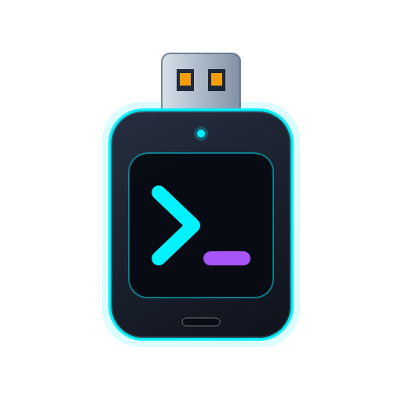

# AgentStick

<p align="center">
  
</p>

<p align="center">
  <b>Suíte Portátil Multi-Agente de Inteligência Artificial em Pendrive USB para Diagnóstico, Automação e Suporte Técnico no Windows</b>
</p>

<p align="center">
  <a href="README.md"></a>
  <a href="docs/README.en.md"></a>
  <a href="docs/README.it.md"></a>
</p>

<p align="center">
  
  
  
  <a href="LICENSE"></a>
</p>

---

## 📌 Visão Geral

O **OpenCode Portable** transforma seu **pendrive USB** ou disco externo em uma suíte multi-agente 100% autônoma e portátil para Windows. Projetado para técnicos, desenvolvedores e administradores de sistemas, ele permite instalar e executar **OpenCode**, **Claude Code**, **GitHub Copilot CLI** e **Antigravity CLI** diretamente do pendrive sem exigir instalação prévia, sem privilégios de administrador e sem deixar credenciais ou arquivos residuais na máquina hospedeira.

### Principais Recursos

* 🔌 **Zero Instalação e Multi-Agente:** Escolha quais agentes deseja levar no pendrive e execute imediatamente em qualquer PC Windows.
* 🛡️ **Isolamento Absoluto e Zero Rastro:** Cada agente possui seu próprio diretório isolado em `.\data\<agente>`, impedindo qualquer vazamento de credenciais em `%USERPROFILE%` ou `%APPDATA%` do PC host.
* ⚡ **Compatibilidade Corporativa:** Compatível com políticas de segurança do Windows 11 (Smart App Control / Code Integrity) com validação de assinatura digital Authenticode.
* 🧠 **Workspace e Skills Compartilhados:** Todos os agentes iniciam na pasta `.\Projetos` e compartilham as skills portáteis em `.\skills`.
* 🖥️ **Automação Visual de Desktop (MCP):** Integração com o `agent-desktop` (Vercel Labs) para capturar tela, mover o cursor, clicar e operar aplicativos de desktop.
* 🔄 **Atualizador Inteligente:** Atualiza automaticamente apenas os binários instalados em `.\bin\` ou toda a suíte via `--all`.

---

## 🤖 Agentes Suportados e Isolamento Técnico

| # | Agente | Runtime / Binário em `.\bin\` | Launcher Gerado | Isolamento de Dados e Credenciais |
| :-: | :--- | :--- | :--- | :--- |
| **1** | **OpenCode Portable** | `opencode.exe` + `agent-desktop.exe` (MCP) | `Iniciar OpenCode.bat` | `XDG_CONFIG_HOME`, `XDG_DATA_HOME`, `XDG_CACHE_HOME` e `USERPROFILE` redirecionados para `.\data\opencode` |
| **2** | **Claude Code Portable** | Node.js portátil (`.\bin\node\node.exe`) + `@anthropic-ai/claude-code` | `Iniciar Claude Code.bat` | `USERPROFILE`, `HOME` e `CLAUDE_CONFIG_DIR` isolados em `.\data\claude` (`~/.claude` no pendrive) |
| **3** | **GitHub Copilot CLI** | `gh.exe` estático + extensão Copilot | `Iniciar Copilot.bat` | `GH_CONFIG_DIR`, `USERPROFILE` e `APPDATA` redirecionados para `.\data\gh` |
| **4** | **Antigravity CLI** | `antigravity.exe` / `antigravity.cmd` (Google DeepMind) | `Iniciar Antigravity.bat` | `GEMINI_HOME`, `.gemini` e `ANTIGRAVITY_HOME` redirecionados para `.\data\antigravity` |

---

## 🚀 Instalação Interativa em Pendrive

O repositório inclui um assistente interativo que detecta unidades USB e permite escolher um ou múltiplos agentes:

1. Conecte o seu pendrive na porta USB.
2. Dê um clique duplo em **`instalar-pendrive.bat`** (ou execute `scripts/setup-pendrive.ps1`).
3. Selecione o número da unidade USB desejada (a unidade do sistema `C:` é estritamente bloqueada).
4. No menu de seleção de agentes, escolha uma opção única, múltipla ou a suíte completa:

```text
  [1] OpenCode Portable (com MCP agent-desktop)             (~120 MB)
  [2] Claude Code Portable (com Node.js portátil integrado) (~150 MB)
  [3] GitHub Copilot CLI (com gh.exe portátil)              (~60 MB)
  [4] Antigravity CLI (Google DeepMind)                     (~80 MB)
  [5] Todos os Agentes (Suíte Completa)                     (~410 MB)
```
*(Aceita entradas como `1`, `1,2`, `1,3,4` ou `5`. O instalador calcula automaticamente o espaço livre necessário antes de iniciar).*

### Estrutura Gerada no Pendrive:

```text
D:\ (Pendrive)
├── 📁 Projetos/                 <- Workspace compartilhado por todos os agentes
├── 📁 skills/                   <- Skills compartilhadas (diagnostico-windows, impressora, etc.)
├── ⚙️ Iniciar OpenCode.bat      <- (Se selecionado)
├── ⚙️ Iniciar Claude Code.bat   <- (Se selecionado)
├── ⚙️ Iniciar Copilot.bat       <- (Se selecionado)
└── ⚙️ Iniciar Antigravity.bat   <- (Se selecionado)
(Pastas ocultas com attrib +h: bin/, config/, data/)
```

---

## 💻 Como Usar

### 1. No Pendrive
Basta plugar o pendrive na máquina desejada e clicar duas vezes no launcher do agente escolhido (`Iniciar OpenCode.bat`, `Iniciar Claude Code.bat`, `Iniciar Copilot.bat` ou `Iniciar Antigravity.bat`). Você também pode passar argumentos via linha de comando:
```cmd
"Iniciar OpenCode.bat" --version
"Iniciar Claude Code.bat" --help
"Iniciar Copilot.bat" explain "netstat -ano"
"Iniciar Antigravity.bat"
```

### 2. Uso Local (no Computador)
Se preferir rodar o OpenCode Portable diretamente da pasta clonada no computador:
* **Windows (CMD):** execute `opencode-portable.cmd`
* **Windows (PowerShell):** execute `.\opencode-portable.ps1`
* **Linux / macOS:** execute `./opencode-portable.sh`

---

## 🛠️ Skills e Ferramentas Integradas

| Skill / MCP | Finalidade |
| :--- | :--- |
| **`diagnostico-windows`** | Audita uso de CPU/RAM, investiga telas azuis (BSOD) nos logs de eventos, verifica integridade de discos (SMART), rotas de rede, conexões ativas e serviços do Windows. |
| **`diagnostico-impressora`** | Guia interativo para identificar falhas de impressão, destravar filas e spooler, diagnosticar impressoras offline em portas WSD vs TCP/IP, testar porta 9100 e emitir páginas de teste. |
| **`agent-desktop`** | Servidor MCP nativo que capacita a IA a navegar visualmente pela máquina: tirar screenshots da tela, mover o cursor, clicar em botões e digitar comandos em aplicativos de desktop. |

---

## 🔄 Atualizando os Agentes no Pendrive

Para atualizar automaticamente todos os agentes instalados presentes em `.\bin\`:

```cmd
"Iniciar OpenCode.bat" --atualizar
```
*(ou `--update` em qualquer um dos launchers)*

Para forçar a verificação/atualização de todos os agentes da suíte:
```powershell
powershell -NoProfile -ExecutionPolicy Bypass -File .\scripts\update.ps1 --all
```

---

## 🧪 Testes Automatizados

O projeto conta com uma suíte de testes automatizados (`tests/test-multi-agent-setup.ps1`) que valida sem necessidade de pendrive físico:
* Mock de instalação seletiva e completa (`-Mock -TargetDir $MockDrive -Agents 1,2,3,4`), cálculo de espaço livre e ocultação de pastas (`attrib +h`).
* Isolamento estrito de variáveis de ambiente (garantindo zero vazamento para `%USERPROFILE%` ou `%APPDATA%` fora do diretório portátil).
* Scanner de segredos (`scripts/pack-release.ps1`) e compilação limpa do projeto C# (`dotnet build`).

```powershell
powershell -NoProfile -ExecutionPolicy Bypass -File .\tests\test-multi-agent-setup.ps1
```

---

## 🤝 Créditos e Atribuição

Este projeto foi desenvolvido e adaptado tendo como referência a arquitetura de empacotamento original de [terzastella/opencode-portable](https://github.com/terzastella/opencode-portable).

## 📄 Licença

Distribuído sob a licença [MIT](LICENSE).
