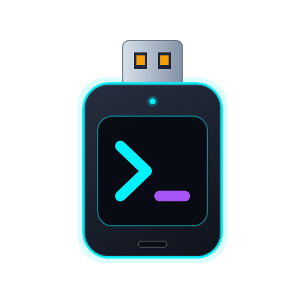

# AgentStick

<p align="center">
  
</p>

<p align="center">
  <b>Portable Multi-Agent AI USB Suite for Windows Diagnostics, Automation, and Technical Support</b>
</p>

<p align="center">
  <a href="../README.md"></a>
  <a href="README.en.md"></a>
  <a href="README.it.md"></a>
</p>

<p align="center">
  
  
  
  <a href="../LICENSE"></a>
</p>

---

## 📌 Overview

**AgentStick** turns any **USB flash drive** or external disk into a 100% self-contained, multi-agent AI field toolkit for Windows. Built for technicians, developers, and system administrators, it lets you interactively install and run **OpenCode**, **Claude Code**, **GitHub Copilot CLI**, and **Antigravity CLI** straight from a USB drive without prior installation, without administrator privileges, and with zero credential or file leakage on the host PC.

### Key Features

* 🔌 **Zero Installation & Multi-Agent Selection:** Choose exactly which AI agents to carry on your USB drive and run them immediately on any Windows machine.
* 🛡️ **Strict Isolation & Zero Residuals:** Every agent is isolated under its own `.\data\<agent>` folder, preventing any credential leakage into the host's `%USERPROFILE%` or `%APPDATA%`.
* ⚡ **Corporate Compatibility:** Runs smoothly under strict Windows 11 policies (Smart App Control / Code Integrity) with Authenticode signature verification.
* 🧠 **Shared Workspace & Portable Skills:** All installed agents start inside `.\Projetos` and share portable skills from `.\skills`.
* 🖥️ **Desktop GUI Automation (MCP):** Native integration with `agent-desktop` (Vercel Labs) to capture screenshots, move the mouse, click buttons, and automate Windows apps.
* 🔄 **Smart Updater:** Conditionally updates installed binaries in `.\bin\` or updates the entire suite via `--all`.

---

## 🤖 Supported Agents & Isolation Architecture

| # | Agent | Runtime / Binary in `.\bin\` | Generated Launcher | Data & Credential Isolation |
| :-: | :--- | :--- | :--- | :--- |
| **1** | **OpenCode** | `opencode.exe` + `agent-desktop.exe` (MCP) | `Iniciar OpenCode.bat` | `XDG_CONFIG_HOME`, `XDG_DATA_HOME`, `XDG_CACHE_HOME`, and `USERPROFILE` redirected to `.\data\opencode` |
| **2** | **Claude Code Portable** | Portable Node.js (`.\bin\node\node.exe`) + `@anthropic-ai/claude-code` | `Iniciar Claude Code.bat` | `USERPROFILE`, `HOME`, and `CLAUDE_CONFIG_DIR` isolated inside `.\data\claude` |
| **3** | **GitHub Copilot CLI** | Static `gh.exe` + Copilot extension | `Iniciar Copilot.bat` | `GH_CONFIG_DIR`, `USERPROFILE`, and `APPDATA` redirected to `.\data\gh` |
| **4** | **Antigravity CLI** | `antigravity.exe` / `antigravity.cmd` (Google DeepMind) | `Iniciar Antigravity.bat` | `GEMINI_HOME`, `.gemini`, and `ANTIGRAVITY_HOME` redirected to `.\data\antigravity` |

---

## 🚀 Interactive Multi-Agent USB Setup

The repository includes an interactive setup wizard to prepare any USB drive:

1. Connect your USB flash drive to your PC.
2. Double-click **`instalar-pendrive.bat`** (or run `scripts/setup-pendrive.ps1`).
3. Select your target USB drive (the system `C:` drive is strictly blocked).
4. In the interactive agent menu, pick a single agent, a custom combination, or the complete suite:

```text
  [1] OpenCode (with MCP agent-desktop)                     (~120 MB)
  [2] Claude Code Portable (com Node.js portátil integrado) (~150 MB)
  [3] GitHub Copilot CLI (com gh.exe portátil)              (~60 MB)
  [4] Antigravity CLI (Google DeepMind)                     (~80 MB)
  [5] Todos os Agentes (Suíte Completa)                     (~410 MB)
```
*(Accepts inputs such as `1`, `1,2`, `1,3,4`, or `5`. The installer calculates required free space for the selected agents and alerts/aborts if the USB drive lacks sufficient space).*

### USB Drive Layout After Installation:

```text
D:\ (USB Drive)
├── 📁 Projetos/                 <- Shared workspace across all agents
├── 📁 skills/                   <- Shared skills (diagnostico-windows, impressora, etc.)
├── ⚙️ Iniciar OpenCode.bat      <- (If selected)
├── ⚙️ Iniciar Claude Code.bat   <- (If selected)
├── ⚙️ Iniciar Copilot.bat       <- (If selected)
└── ⚙️ Iniciar Antigravity.bat   <- (If selected)
(Hidden folders with attrib +h: bin/, config/, data/)
```

---

## 💻 How to Use

### 1. On a USB Flash Drive
Plug the USB drive into the target Windows PC and double-click the desired agent launcher (`Iniciar OpenCode.bat`, `Iniciar Claude Code.bat`, `Iniciar Copilot.bat`, or `Iniciar Antigravity.bat`), or pass CLI arguments directly:
```cmd
"Iniciar OpenCode.bat" --version
"Iniciar Claude Code.bat" --help
"Iniciar Copilot.bat" explain "netstat -ano"
"Iniciar Antigravity.bat"
```

### 2. Local Use (on Your Computer)
To run directly from the cloned repository folder:
* **Windows (CMD):** execute `opencode-portable.cmd`
* **Windows (PowerShell):** execute `.\opencode-portable.ps1`
* **Linux / macOS:** execute `./opencode-portable.sh`

---

## 🛠️ Built-in Skills & Tools

| Skill / MCP | Purpose |
| :--- | :--- |
| **`diagnostico-windows`** | Audits CPU/RAM utilization, investigates BSOD crashes in Windows Event Logs, checks disk health (SMART), reviews network routing, and inspects active Windows services. |
| **`diagnostico-rede`** | Layered network troubleshooting for connectivity drops, Wi-Fi signal/reports, packet loss, jitter, DNS resolution, TCP ports, traceroute, SMB shares, VPN/proxy/firewall, and DHCP/IP conflicts. |
| **`diagnostico-impressora`** | Interactive assistant to diagnose printer failures, clear stuck print queues and reset Spooler, troubleshoot offline printers on WSD vs TCP/IP ports, test port 9100 connectivity, and print test pages. |
| **`ferramentas-portateis`** | Pre-installed portable CLI toolkit in `.\bin\` (`rg.exe`, `fd.exe`, `jq.exe`, `sqlite3.exe`) + official **Microsoft Sysinternals** utilities (`handle`, `pslist`, `autorunsc` with `-accepteula`). |
| **`agent-desktop`** | Native Model Context Protocol (MCP) server enabling visual desktop interaction: screen capture, mouse movement, button clicks, and keyboard input. |

---

## 🔄 Updating Agents on the USB Drive

To update all installed binaries present in `.\bin\`:

```cmd
"Iniciar OpenCode.bat" --update
```
*(or `--atualizar` on any generated launcher)*

To force checking/updating all supported agents in the suite:
```powershell
powershell -NoProfile -ExecutionPolicy Bypass -File .\scripts\update.ps1 --all
```

---

## 🧪 Automated Test Suite

Run `tests/test-multi-agent-setup.ps1` to verify the installer without needing a physical USB flash drive:
* Mock installation (`-Mock -TargetDir $MockDrive -Agents 1,2,3,4`), partial agent selection, free-space guard, and hidden folders (`attrib +h`).
* Environment variable isolation (verifying zero leakage to host `%USERPROFILE%` or `%APPDATA%` outside the mock directory).
* Package secret scan (`scripts/pack-release.ps1`) and clean C# build (`dotnet build`).

```powershell
powershell -NoProfile -ExecutionPolicy Bypass -File .\tests\test-multi-agent-setup.ps1
```

---

## 🤝 Credits & Attribution

This project is built upon and adapted from the initial packaging architecture of [terzastella/opencode-portable](https://github.com/terzastella/opencode-portable).

## 📄 License

Distributed under the [MIT](../LICENSE) License.
