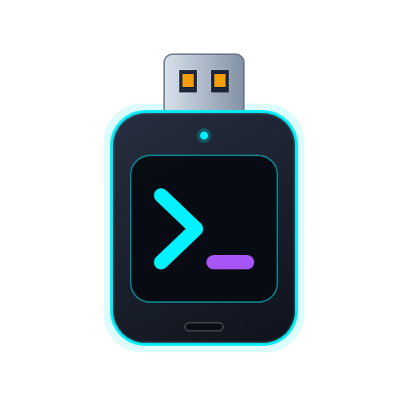

# AgentStick

<p align="center">
  
</p>

<p align="center">
  <b>Suite Portatile Multi-Agente di Intelligenza Artificiale su USB per Diagnostica, Automazione e Supporto Tecnico su Windows</b>
</p>

<p align="center">
  <a href="../README.md"></a>
  <a href="README.en.md"></a>
  <a href="README.it.md"></a>
</p>

<p align="center">
  
  
  
  <a href="../LICENSE"></a>
</p>

---

## 📌 Panoramica

**OpenCode Portable** trasforma qualsiasi **chiavetta USB** o disco esterno in una suite multi-agente di IA completamente autonoma e portatile per Windows. Progettato per tecnici, sviluppatori e amministratori di sistema, permette di selezionare e installare **OpenCode**, **Claude Code**, **GitHub Copilot CLI** e **Antigravity CLI** direttamente su USB senza alcuna installazione sul PC ospite, senza privilegi di amministratore e senza lasciare credenziali o tracce sul computer host.

### Caratteristiche Principali

* 🔌 **Zero Installazione e Multi-Agente:** Scegli interattivamente quali agenti installare sulla chiavetta USB ed eseguili subito su qualsiasi PC Windows.
* 🛡️ **Isolamento Assoluto e Zero Residui:** Ogni agente utilizza una propria cartella isolata in `.\data\<agente>`, evitando qualsiasi fuoriuscita di credenziali in `%USERPROFILE%` o `%APPDATA%` del PC host.
* ⚡ **Compatibilità Aziendale:** Compatibile con i criteri di sicurezza di Windows 11 (Smart App Control / Code Integrity) con verifica della firma digitale Authenticode.
* 🧠 **Workspace e Skill Condivisi:** Tutti gli agenti si avviano direttamente nella cartella `.\Projetos` e condividono le skill portatili in `.\skills`.
* 🖥️ **Automazione Desktop GUI (MCP):** Integrazione con `agent-desktop` (Vercel Labs) per catturare schermate, muovere il cursore, fare clic e interagire con le finestre di Windows.
* 🔄 **Aggiornatore Intelligente:** Aggiorna condizionalmente i binari presenti in `.\bin\` oppure l'intera suite tramite il flag `--all`.

---

## 🤖 Agenti Supportati e Isolamento Tecnico

| # | Agente | Runtime / Binario in `.\bin\` | Launcher Generato | Isolamento Dati e Credenziali |
| :-: | :--- | :--- | :--- | :--- |
| **1** | **OpenCode Portable** | `opencode.exe` + `agent-desktop.exe` (MCP) | `Iniciar OpenCode.bat` | `XDG_CONFIG_HOME`, `XDG_DATA_HOME`, `XDG_CACHE_HOME` e `USERPROFILE` reindirizzati in `.\data\opencode` |
| **2** | **Claude Code Portable** | Node.js portatile (`.\bin\node\node.exe`) + `@anthropic-ai/claude-code` | `Iniciar Claude Code.bat` | `USERPROFILE`, `HOME` e `CLAUDE_CONFIG_DIR` isolati in `.\data\claude` |
| **3** | **GitHub Copilot CLI** | `gh.exe` statico + estensione Copilot | `Iniciar Copilot.bat` | `GH_CONFIG_DIR`, `USERPROFILE` e `APPDATA` reindirizzati in `.\data\gh` |
| **4** | **Antigravity CLI** | `antigravity.exe` / `antigravity.cmd` (Google DeepMind) | `Iniciar Antigravity.bat` | `GEMINI_HOME`, `.gemini` e `ANTIGRAVITY_HOME` reindirizzati in `.\data\antigravity` |

---

## 🚀 Installazione Interattiva Multi-Agente su USB

Il repository include una procedura guidata per preparare qualsiasi chiavetta USB:

1. Collega la chiavetta USB al computer.
2. Fai doppio clic su **`instalar-pendrive.bat`** (oppure esegui `scripts/setup-pendrive.ps1`).
3. Seleziona il numero dell'unità USB di destinazione (l'unità di sistema `C:` è rigorosamente bloccata).
4. Nel menu interattivo, seleziona uno o più agenti oppure la suite completa:

```text
  [1] OpenCode Portable (com MCP agent-desktop)             (~120 MB)
  [2] Claude Code Portable (com Node.js portátil integrado) (~150 MB)
  [3] GitHub Copilot CLI (com gh.exe portátil)              (~60 MB)
  [4] Antigravity CLI (Google DeepMind)                     (~80 MB)
  [5] Todos os Agentes (Suíte Completa)                     (~410 MB)
```
*(Accetta combinazioni come `1`, `1,2`, `1,3,4` oppure `5`. L'installer calcola lo spazio libero richiesto dagli agenti scelti e avvisa/interrompe se lo spazio sulla chiavetta non è sufficiente).*

### Struttura Creata sulla Chiavetta USB:

```text
D:\ (Chiavetta USB)
├── 📁 Projetos/                 <- Workspace condiviso da tutti gli agenti
├── 📁 skills/                   <- Skill condivise (diagnostico-windows, impressora, ecc.)
├── ⚙️ Iniciar OpenCode.bat      <- (Se selezionato)
├── ⚙️ Iniciar Claude Code.bat   <- (Se selezionato)
├── ⚙️ Iniciar Copilot.bat       <- (Se selezionato)
└── ⚙️ Iniciar Antigravity.bat   <- (Se selezionato)
(Cartelle nascoste con attrib +h: bin/, config/, data/)
```

---

## 💻 Modalità d'Uso

### 1. Su Chiavetta USB
Collega la chiavetta al PC Windows e avvia il launcher dell'agente desiderato (`Iniciar OpenCode.bat`, `Iniciar Claude Code.bat`, `Iniciar Copilot.bat` o `Iniciar Antigravity.bat`), anche passando argomenti da riga di comando:
```cmd
"Iniciar OpenCode.bat" --version
"Iniciar Claude Code.bat" --help
"Iniciar Copilot.bat" explain "netstat -ano"
"Iniciar Antigravity.bat"
```

### 2. Uso Locale (sul Computer)
Per eseguire OpenCode Portable direttamente dalla cartella clonata sul PC:
* **Windows (CMD):** esegui `opencode-portable.cmd`
* **Windows (PowerShell):** esegui `.\opencode-portable.ps1`
* **Linux / macOS:** esegui `./opencode-portable.sh`

---

## 🛠️ Skill e Strumenti Integrati

| Skill / MCP | Scopo |
| :--- | :--- |
| **`diagnostico-windows`** | Analizza l'uso di CPU/RAM, indaga sui crash BSOD nei log eventi di Windows, verifica lo stato dei dischi (SMART), controlla le rotte di rete e verifica i servizi attivi. |
| **`diagnostico-rede`** | Diagnostica di rete a livelli per connettività, Wi-Fi, perdita di pacchetti, jitter, DNS, porte TCP, traceroute, condivisioni SMB, VPN/proxy/firewall e conflitti IP/DHCP. |
| **`diagnostico-impressora`** | Assistente interattivo per diagnosticare problemi di stampa, sbloccare code e riavviare lo Spooler, risolvere stampanti offline su porte WSD vs TCP/IP, testare la porta 9100 e stampare pagine di prova. |
| **`agent-desktop`** | Server MCP nativo che permette all'IA di interagire visivamente con il desktop: catturare screenshot, muovere il mouse, fare clic su pulsanti e inviare input da tastiera. |

---

## 🔄 Aggiornamento degli Agenti sulla Chiavetta

Per aggiornare condizionalmente tutti i binari installati presenti in `.\bin\`:

```cmd
"Iniciar OpenCode.bat" --atualizar
```
*(oppure `--update` su qualsiasi launcher)*

Per forzare il controllo/aggiornamento di tutti gli agenti della suite:
```powershell
powershell -NoProfile -ExecutionPolicy Bypass -File .\scripts\update.ps1 --all
```

---

## 🧪 Suite di Test Automatizzati

Il file `tests/test-multi-agent-setup.ps1` verifica l'intera architettura senza bisogno di una chiavetta USB fisica:
* Mock di installazione (`-Mock -TargetDir $MockDrive -Agents 1,2,3,4`), selezione parziale degli agenti, calcolo dello spazio libero e cartelle nascoste (`attrib +h`).
* Isolamento delle variabili d'ambiente (nessun riferimento a `%USERPROFILE%` o `%APPDATA%` fuori dalla cartella mock).
* Scanner dei segreti (`scripts/pack-release.ps1`) e compilazione C# (`dotnet build`).

```powershell
powershell -NoProfile -ExecutionPolicy Bypass -File .\tests\test-multi-agent-setup.ps1
```

---

## 🤝 Crediti e Riconoscimenti

Questo progetto è stato sviluppato e adattato prendendo come riferimento l'architettura originale di [terzastella/opencode-portable](https://github.com/terzastella/opencode-portable).

## 📄 Licenza

Distribuito con licenza [MIT](../LICENSE).
